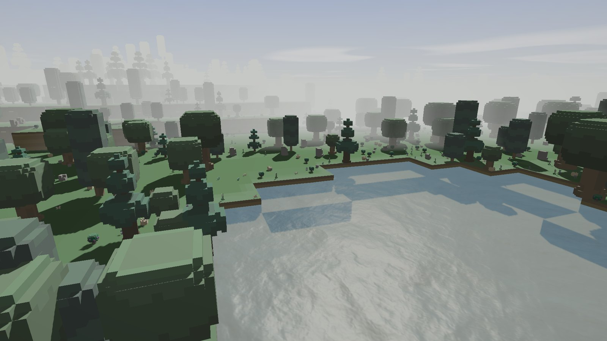

# Small World

一个没有玩家操作也会继续运转的体素世界。

[打开公开页](https://breezedropsleezes.github.io/small-world/) · [居民智能结构](https://breezedropsleezes.github.io/small-world/resident.html) · [最新日志](https://breezedropsleezes.github.io/small-world/log/2026-10-20.html)



## 这是什么

这是一个体素世界模拟项目。地形、材料、时间、昼夜、温度与燃烧共享同一套规则；居民有饥饿与疲劳，会感知周围、做出决定并执行行动。项目先从世界规则入手，先建立能够独立运转的模拟，再引入玩家参与。

这个仓库只放公开页面、开发日志和版本说明，不包含 Unity 工程。游戏源码与设计文档不在这个仓库里；代码这一期暂不公开。

## 素材来源、版权与使用

本项目目前使用的所有素材均来源于《石炉》（Stonehearth），相关素材与截图的版权归原作者及权利方所有，不在本项目的授权范围内。

除上述第三方素材外，页面文字与页面代码版权归 BreezedropSleezes 所有。本项目仅用于学习与展示，不进行任何商业用途；未经许可，请勿将本项目内容用于商业用途或再分发。如相关权利方认为使用不当，请联系我处理。

## 现在

- **世界模拟**：已完成。没有居民时，物质、时间、昼夜与地形仍能持续运转。
- **居民智能**：进行中。需求、感知、决策与行动已经接入；建造、寻路与材料搬运仍在开发。
- **基础系统**：已接入。统一时间轴、种子与配置。

Windows 版本还没有发布；构建完成后会放在 [Releases](https://github.com/BreezedropSleezes/small-world/releases)。

## 居民智能

每个居民在需求、环境与已有计划之间做出选择；决策会转化为行动，并通过结果判断目标是否推进。高层模型负责任务选择，具体执行由规则系统与行为配方完成。

[查看居民智能结构 →](https://breezedropsleezes.github.io/small-world/resident.html)

## 页面

- [首页](https://breezedropsleezes.github.io/small-world/)：项目概览、当前进度与游戏截图
- [居民智能](https://breezedropsleezes.github.io/small-world/resident.html)：决策循环、两层循环与决策上下文
- [2026-10-20 日志](https://breezedropsleezes.github.io/small-world/log/2026-10-20.html)：阴影像素对齐与村庄袭击接入
- [2026-10-19 日志](https://breezedropsleezes.github.io/small-world/log/2026-10-19.html)：第一阶段收尾记录

## 仓库结构

| 路径 | 内容 |
|---|---|
| `index.html` | 公开首页 |
| `resident.html` | 居民智能结构页 |
| `site.css` | 页面样式 |
| `assets/` | 游戏截图、居民智能结构图与开发日志视频 |
| `log/` | 开发日志 |
| `README.md` | 仓库说明 |

## 技术

- Unity / C#
- 体素材料与统一的世界规则
- 需求 → 感知 → 决策 → 执行 → 反馈 的居民循环
- 统一时间轴、配置驱动、同种子同结果

## 本地预览

这个仓库是纯静态页面。在仓库根目录运行：

```bash
python -m http.server 8000
```

然后打开 `http://localhost:8000/`。

## 关于

BreezedropSleezes，独立开发者。项目从世界规则开始，先让世界成立，再考虑玩家怎么参与。

[GitHub](https://github.com/BreezedropSleezes)
